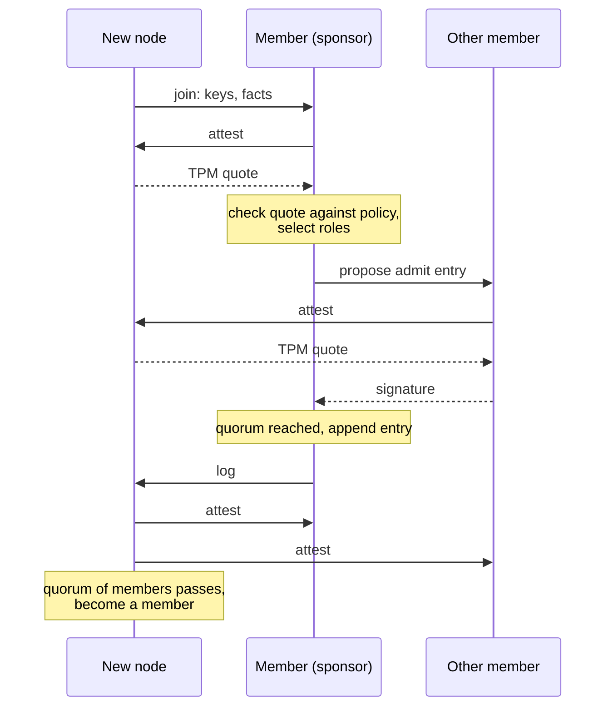

# fistpumpd

fistpumpd is a membership daemon for small clusters of machines that have a TPM 2.0 and measured boot. The members keep a signed, hash-chained log of who is in the cluster and which roles each machine holds. A machine is admitted only after the existing members have checked its TPM quote against a signed policy and a quorum has signed its admission. Each member then writes its local configuration from that log.

There is no central server, no join token to hand out and no per-node configuration: every machine boots the same signed image.

<p align="center">
  
</p>

## Why

Bringing up a cluster normally needs something outside the cluster: a provisioning server, an inventory of host names, or a shared secret copied to each machine. Each of those is one more thing to run and protect, and a secret proves only that a machine was given it, not what the machine runs.

fistpumpd moves that decision into the cluster and ties it to the hardware:

1. A node joins only if its TPM proves that it booted software your policy accepts. Members keep attesting each other afterwards and vote out a peer that stops passing.
2. Members agree by quorum, so no machine is special. The only trusted party is the key that signs your OS image and your topology.
3. Roles are assigned by rules over what a node reports about itself (architecture, memory, disk, board), in the manner of a Kubernetes `nodeSelector`. The same image works for any number of machines.
4. The order of admission gives every node a rank. Anything that needs an order, f.e. floating address priorities or which node initializes a database, follows from the log instead of from host names.
5. A lone node never starts the cluster. Two machines that boot at the same time elect one founder, so they cannot each initialize their own.
6. The log is public and verifiable offline: `fistpumpd verify` checks every signature without access to the cluster.

It was written to bring up [k3s](https://k3s.io/) with [keepalived](https://www.keepalived.org/) on Raspberry Pi 4 boards, but nothing in the membership logic is specific to either. What a role writes to disk comes from templates in the topology.

## How it works

Every node runs `fistpumpd daemon`. On boot the node looks for members with a UDP broadcast on the local network.

- If a member answers, the node asks to join. The members verify its TPM quote, pick its roles from the topology and sign its admission. The node then attests the members itself before it trusts the log it was given.
- If nobody answers, the node waits (`founder_wait`, 20 seconds by default) and founds a new log if it is the only candidate, or the one with the lowest endorsement key hash.

An admission with two members in the cluster:



On every change of the log a member applies what follows from it:

- role markers in `/etc/machine-role.d/` and machine tags (`hostnamectl tags`),
- the files listed in the topology, rendered from templates, with the units to reload, start or stop when a file changes,
- for the roles `server` and `agent`, the k3s tokens: the first server creates them, the others fetch them from a member over pinned TLS, and each node stores them with `systemd-creds`, sealed to its TPM.

[docs/protocol.md](docs/protocol.md) describes the log format, the consensus rule, attestation and the failure handling.

## Requirements

- Linux with systemd. The daemon runs as root.
- A TPM 2.0 and [tpm2-tools](https://github.com/tpm2-software/tpm2-tools).
- Measured boot, with the OS image measured into PCR 11 _(as a systemd unified kernel image does)_.
- A signed policy of accepted PCR values, published over HTTPS. The format is in the [protocol document](docs/protocol.md#trusted-inputs).
- `gpg` to check that policy, and `systemd-creds` to seal the k3s tokens.
- All nodes in one broadcast domain, or `seeds` set in the genesis file.

## Install

Releases carry static binaries for `linux/amd64` and `linux/arm64`, and a `SHA256SUMS` file:

```bash
curl -fLO https://github.com/valtzu/fistpumpd/releases/latest/download/fistpumpd-arm64
curl -fLO https://github.com/valtzu/fistpumpd/releases/latest/download/SHA256SUMS
sha256sum --check --ignore-missing SHA256SUMS
install -m 0755 fistpumpd-arm64 /usr/bin/fistpumpd
```

Run `fistpumpd daemon` from a unit that starts after the network has a default route and the TPM is available. The daemon keeps its state in `/var/lib/fistpumpd`.

## Configuration

The daemon reads these files. All of them are meant to ship in the signed OS image, or in a signed extension of it, because the members trust them without further checks.

| File | Purpose |
|---|---|
| `/usr/lib/fistpumpd/genesis.json` | cluster-wide settings |
| `/etc/fistpumpd/topology.json`, else `/usr/lib/fistpumpd/topology.json` | roles, floating addresses, files |
| `/usr/lib/verity.d/mkosi.crt` | certificate of the build key, needed to accept a recovery entry |
| `/usr/lib/systemd/import-pubring.pgp` | keyring that the policy signature is checked against |

### Genesis

```json
{
  "min_members": 2,
  "policy_urls": ["https://example.org/updates/stable"]
}
```

| Key | Default | Meaning |
|---|---|---|
| `min_members` | 2 | at least 2. Templates read it as `.MinMembers`, f.e. to hold a service back until enough members are admitted |
| `policy_urls` | | where the signed policy is fetched from, merged across URLs |
| `port` | 17947 | member RPC, TLS |
| `discovery_port` | 17946 | discovery, UDP broadcast |
| `api_port` | 17948 | read API |
| `api_client_ca` | `/etc/fistpumpd/api-client-ca.pem` | a path or a list of paths, see [Read API](#read-api) |
| `seeds` | | member addresses (`host:port`) to try besides discovery |
| `founder_wait` | 20 | seconds a node waits for a member before it founds a log |
| `attest_interval` | 30 | seconds between attestations of a peer |
| `evict_after` | 300 | seconds a peer may fail attestation before its eviction is proposed |

### Topology

```json
{
  "version": 1,
  "roles": [
    {"name": "server", "selector": {"arch": "arm64", "memory-gib": ">=4"}, "min": 3, "max": 3, "conflicts": ["agent"]},
    {"name": "agent", "selector": {"arch": "arm64"}},
    {"name": "ingress"}
  ],
  "vips": {
    "server": ["192.168.1.20"],
    "ingress": ["192.168.1.30", "192.168.1.31"]
  },
  "files": [
    {
      "path": "/etc/rancher/k3s/config.yaml.d/10-role.yaml",
      "roles": ["server", "agent"],
      "template": [
        "{{- if .IsFirst \"server\" -}}",
        "cluster-init: true",
        "{{- else -}}",
        "server: https://{{index (.Vips \"server\") 0}}:6443",
        "{{- end}}"
      ]
    }
  ]
}
```

Roles are listed in priority order. A node takes every role whose selector matches its facts, that does not conflict with a role it already took, and whose `max` is not reached.

- The facts are `arch`, `memory-gib`, `disk-gib` (the largest disk that is not the OS disk), `cpu-count`, `board` and `tpm`.
- A selector value is an exact value, a comparison (`>=`, `<=`, `>`, `<`, `!=`) or a list meaning any of. A role without a selector matches every node.
- `min` does not gate anything. `fistpumpd status` reports roles that have fewer holders than `min`.
- Roles are fixed at admission. To move a node to other roles, evict it and let it join again.
- `"unmatched": "refuse"` turns away nodes that match no role.

A file is written on nodes that hold one of its `roles`, or on every node when `roles` is absent. Templates are Go `text/template` and see only values derived from the log, so every member renders the same text. `reload`, `start` and `stop` name systemd units to act on when the text changes. The [protocol document](docs/protocol.md#what-a-member-configures) lists the template values.

To change the topology of a running cluster, raise `version` and ship the new file to all members. They record the change in the log once a quorum holds the same file.

## Usage

```
fistpumpd daemon                                  run the member
fistpumpd status                                  members, roles, failing peers
fistpumpd log                                     the log as JSON
fistpumpd evict NODE [--reason TEXT]              propose removing a member, by node number
fistpumpd verify [--certificate FILE] < log.json  check a log from outside the cluster
fistpumpd version
```

An evicted node stops. To let it join again, remove `/var/lib/fistpumpd` on it and restart the daemon.

### Read API

A member can serve its copy of the log as a read-only, Kubernetes-style API, so `kubectl` lists members and roles even when no Kubernetes is running. The API is enabled when a client CA file exists (`api_client_ca`), and clients authenticate with a certificate signed by it.

```bash
kubectl --server=https://<member>:17948 --insecure-skip-tls-verify --client-certificate=client.pem --client-key=client-key.pem get machines,machinesets
```

### Recovery after a lost quorum

If too many members are gone for the rest to reach a quorum, the holder of the build key decides which members stay:

```
fistpumpd log > log.json                          on a surviving member
fistpumpd reset-sign --log log.json --key build.key --certificate build.crt --keep 0,2 > reset.json
fistpumpd submit reset.json                       on a surviving member
```

`reset-sign` runs offline, on the machine that holds the build key. `--keep` takes the slots that `fistpumpd status` shows.

## Limits

- The TPM code is tested against a software TPM ([swtpm](https://github.com/stefanberger/swtpm)) and a simulated network. It has seen little use on physical hardware.
- Endorsement key certificates are not checked. Attestation stops a real board that runs other software, but not a party on the local network that emulates a whole TPM in software.
- Below four members a cluster tolerates crashes, not a malicious member. A two-member cluster cannot change its membership while either member is down.
- A member's address is fixed at admission. A node whose address changes must be evicted and admitted again.
- Discovery is not authenticated: a party on the local network can keep nodes from founding a cluster.

The [protocol document](docs/protocol.md#limits) has the full list.

## License

MIT. See [LICENSE](LICENSE).
